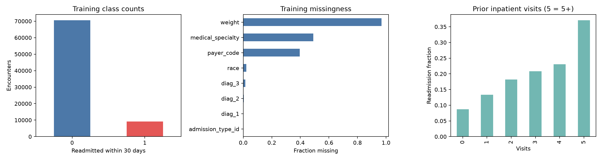
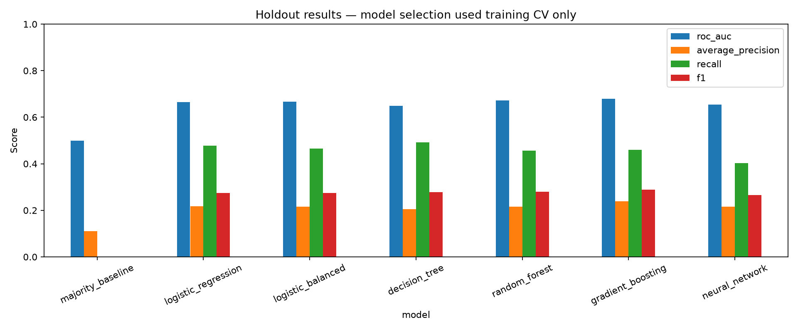
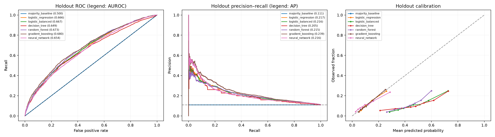
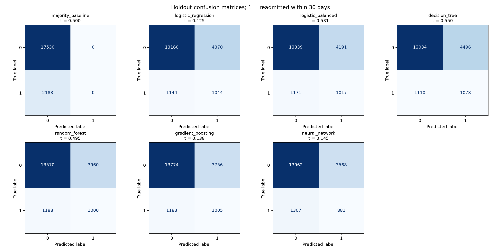
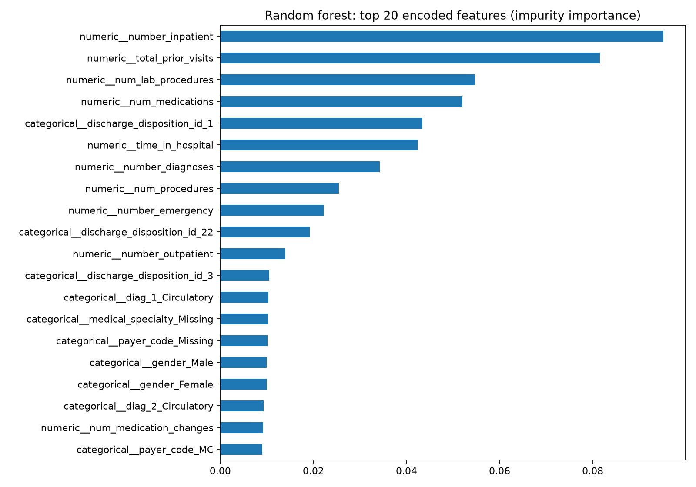

# Diabetes readmission experiment — full dataset

Generated from an actual run. Positive class: readmitted within 30 days.

## Data and protocol

- Raw encounters: 101,766; eligible encounters in this run: 99,343.
- Death/hospice exclusions in the full source: 2,423.
- Training: 79,625 encounters (55,952 patients).
- Test: 19,718 encounters (14,038 patients).
- Test encounter fraction: 19.85%; positive rate: 11.10%.
- Shared patients between train/test and between fit/validation in every fold: **0**.
- 5-fold stratified, patient-grouped CV on training data; fixed seed 42.
- Small grid search optimized average precision (AP); threshold maximized training out-of-fold F1.
- All preprocessing was fitted inside each training fold. The test set was used only after selection.
- Model selected by mean CV AP before test evaluation: **gradient_boosting**.
- Runtime: 11.3 minutes. Package versions and file hash: `run_metadata.json`.

Training diagnostics:

No training warnings were recorded.

## Training cross-validation (development estimates)

| model | cv_ap_mean | cv_ap_std | cv_roc_auc_mean | threshold |
| --- | --- | --- | --- | --- |
| majority_baseline | 0.1146 | 0.0020 | 0.5000 | 0.5000 |
| logistic_regression | 0.2166 | 0.0047 | 0.6627 | 0.1254 |
| logistic_balanced | 0.2162 | 0.0051 | 0.6638 | 0.5315 |
| decision_tree | 0.2012 | 0.0089 | 0.6423 | 0.5503 |
| random_forest | 0.2143 | 0.0074 | 0.6678 | 0.4950 |
| gradient_boosting | 0.2334 | 0.0070 | 0.6716 | 0.1383 |
| neural_network | 0.2160 | 0.0063 | 0.6598 | 0.1453 |

These CV scores describe the selected settings on the same folds used for tuning. They can
be optimistic; they are not nested-CV estimates or confidence intervals. Training out-of-fold
scores also support threshold selection and must not be presented as independent test results.

## Untouched holdout results at the validation-selected thresholds

| model | roc_auc | average_precision | accuracy | balanced_accuracy | precision | recall | f1 | brier_score |
| --- | --- | --- | --- | --- | --- | --- | --- | --- |
| majority_baseline | 0.5000 | 0.1110 | 0.8890 | 0.5000 | 0.0000 | 0.0000 | 0.0000 | 0.0987 |
| logistic_regression | 0.6658 | 0.2167 | 0.7204 | 0.6139 | 0.1928 | 0.4771 | 0.2747 | 0.0945 |
| logistic_balanced | 0.6670 | 0.2163 | 0.7281 | 0.6129 | 0.1953 | 0.4648 | 0.2750 | 0.2247 |
| decision_tree | 0.6490 | 0.2052 | 0.7157 | 0.6181 | 0.1934 | 0.4927 | 0.2778 | 0.2254 |
| random_forest | 0.6729 | 0.2154 | 0.7389 | 0.6156 | 0.2016 | 0.4570 | 0.2798 | 0.1923 |
| gradient_boosting | 0.6798 | 0.2386 | 0.7495 | 0.6225 | 0.2111 | 0.4593 | 0.2893 | 0.0932 |
| neural_network | 0.6536 | 0.2163 | 0.7528 | 0.5996 | 0.1980 | 0.4027 | 0.2655 | 0.0950 |

The CV-selected model obtained test AUROC **0.6798**, AP **0.2386**,
recall **0.4593**, and F1 **0.2893**, using threshold **0.1383**.
The majority baseline obtained accuracy **0.8890** with recall **0.0000**.
This shows why accuracy alone is insufficient. AP summarizes the precision–recall curve using
scikit-learn's average-precision definition, not trapezoidal PR area. The no-skill AP reference
is the test positive fraction (0.1110). Lower Brier score is better.

`test_metrics.csv` also contains results at 0.5 for every model. Comparing those rows with
the chosen-threshold rows separates the effect of threshold selection from model ranking.
Compare the two logistic models to examine class weighting; both also receive their own small
regularization search. Weighted scores are not necessarily calibrated probabilities.

## Figures and interpretation

Forest importance reflects model splits, can favor high-cardinality features, and does not
establish causes of readmission. Calibration plots describe the raw scores; no calibration
model was fitted. F1 optimization is an academic choice, not a clinical operating threshold.

## Scope and limitations

This is an educational, retrospective encounter-level experiment with patient-disjoint evaluation.
Frequent patients contribute more encounters to the metrics. It is not prospective or external
hospital validation, and the random split does not estimate performance in a future year.
The source covers 1999–2008; sensitive demographic attributes are retained, and subgroup
fairness has not been established. Prediction is at discharge, when diagnoses, medication
changes, and discharge disposition are available. Readmissions outside the source network
may be missed. Performance does not establish clinical usefulness.

The implementation deliberately omits nested CV, SMOTE, deep networks, and exact paper
replications. It uses scikit-learn histogram gradient boosting instead of XGBoost. Literature
results with different cohorts and splits must be discussed as context, not direct benchmarks.
See `../docs/methodology.md` for the mapping to the proposal and supplied examples.
